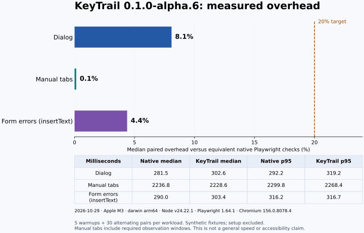

# KeyTrail

**Final reliability verified:** The frozen `1187fde` candidate completed **100 × 172 = 17,200** sequential test executions and **172** matching four-worker checks, with a **100 ms** limit and zero retries/skips. All 101 raw reports were independently validated. Development still defaults to four rounds. See the [protocol and retained results](docs/reliability.md). Ordinary CI checks the real package and clean consumers without claiming final acceptance.

**Frozen candidate:** [candidate/0.1.0-alpha.6](https://github.com/PerchAnton/keytrail/tree/candidate/0.1.0-alpha.6)
remains at `1187fde`, which passed **3 × 172 ARM checks and
172 Linux checks**, including both package consumers in each job, with no retries.
Maximum ARM gaps were **87.7 / 65.6 / 50.7 ms**, below the unchanged **100 ms** limit.
[Main CI evidence](docs/evidence/ci-main-1187fde.json) · [Why 100 ms](docs/observation-gaps.md).
The benchmark below was measured at `f9c492b`: **108 tests** passed, and its input
hashes match `1187fde`. The [handoff](docs/release-handoff.md) identifies the preserved
395,737-byte Linux archive and its checksum.
Short checks do not guarantee host scheduling latency. The final local series is now
complete; [independent validation](docs/evidence/reliability-validation-1187fde.json)
binds all 101 reports to this candidate. Release archive verification and publication
remain pending; the preserved CI archive keeps its development verification level.

Inspect the remaining saved evidence with `node scripts/check-release-readiness.mjs`
from the repository root. This read-only command does not start tests or publish a package.

**Check dialog, tabs and form-error keyboard journeys in your existing Playwright tests.** Declare the
expected focus order; KeyTrail presses keys, checks the result and attaches a report
showing the first mismatch and the observations that could not run.

[](https://github.com/PerchAnton/keytrail/actions/workflows/ci.yml)
[Dialog API](docs/api.md) · [Tabs API](docs/tabs.md) · [Form errors API](docs/form-errors.md) · [CI guard](docs/ci-guard.md) · [Read reports](docs/reports.md) · [Limits](docs/limits.md) · [Performance](docs/performance.md) · [Release checklist](docs/release-checklist.md)

**Status: dialogs, tabs and form errors, `0.1.0-alpha.6` source/package candidate.** No npm
publication or GitHub release yet. This milestone implements custom ARIA dialogs, fixed tab lists and
declared form-error recovery, plus a CI reporter that requires complete results for every discovered journey test and attempt.

```text
Tab to trigger → Enter → initial focus → Tab cycle → Shift+Tab cycle → Escape
                                                                         ↓
                                                           focus returns to trigger
```

If the dialog closes but leaves focus on the page body:

```text
D07 FOCUS_MISMATCH expected=open-profile observed=body
```

The corrected component passes the same contract. The runnable example includes both
versions; its intentionally broken fixture is our teaching example, not an upstream bug.

## Try the packaged example

Node.js 24 and pnpm 11.25.0 are used for development. The tested Playwright peer version
is **1.64.1**, with its Chromium **156.0.8078.4**. [Compatibility](docs/compatibility.md).

```sh
git clone https://github.com/PerchAnton/keytrail.git
cd keytrail
pnpm install --frozen-lockfile --ignore-scripts
pnpm --dir examples/react-portal install --frozen-lockfile --ignore-scripts
pnpm exec playwright install chromium
pnpm build
pnpm test:package
```

On Linux, install Chromium's system dependencies with
`pnpm exec playwright install --with-deps chromium` when needed.
The package check installs the actual archive into two fresh offline consumers.
It checks ESM/CJS imports and types, then runs the vanilla dialog, tabs and form
examples and the React portal example. Corrected journeys also run with the
installed CI guard; a separate defective React process must exit 1 while preserving
its HTML/JUnit reports and incomplete attachment. Dependency installation and the
React lockfile preparation use the registry. The actual consumer installation then
uses `--offline --frozen-lockfile` in a separate empty directory; browser tests need
only the local fixture server.
It leaves `artifacts/keytrail-0.1.0-alpha.6.tgz`, a development verification record
and `SHA256SUMS`. This checks package usability; final acceptance is a separate
[explicit gate](docs/reliability.md).

Install that archive into an existing Playwright project:

```sh
npm install --save-dev /absolute/path/to/keytrail-0.1.0-alpha.6.tgz @playwright/test@1.64.1
```

## Try the React portal

The [React example](examples/react-portal) uses the same dialog contract in
StrictMode, with the dialog mounted outside the app root. Compare correct behavior,
wrong initial focus and lost return focus, then inspect the first mismatch:

```sh
pnpm exec playwright show-report artifacts/consumers/react-portal/reports/teaching/html
```

See [reading reports](docs/reports.md) for the deliberately failing process and its
`not_run` observations. React remains an example dependency, not a library dependency.

## Write a contract

```ts
import { test } from '@playwright/test';
import { assertDialogJourney } from 'keytrail';

test('profile dialog', async ({ page }, testInfo) => {
  await page.goto('/profile'); // Your application and prepared synthetic state.
  const trigger = { id: 'open-profile', locator: page.getByRole('button', { name: 'Edit profile' }) };
  const name = { id: 'display-name', locator: page.getByLabel('Display name') };
  const close = { id: 'close-profile', locator: page.getByRole('button', { name: 'Close' }) };

  await assertDialogJourney(page, testInfo, {
    id: 'profile-dialog', trigger,
    dialog: { id: 'profile', locator: page.getByRole('dialog') },
    openKey: 'Enter', initialFocus: name, tabOrder: [name, close],
    closeKey: 'Escape', returnFocus: trigger,
  });
});
```

Use one journey per test, allow time for setup and reporting (the example uses 45 s),
and let `JourneyAssertionError` fail application tests. Do not catch and ignore it.
The [standalone example](examples/vanilla) provides the actual HTML and configuration;
`/profile` above is an application route, not a service supplied by this package.

## Test a tab list

`assertTabsJourney` checks horizontal/vertical arrow navigation, wraparound, automatic
or manual activation, optional Home/End and the final Tab exit. Manual activation
checks that focus moves while selection stays unchanged until Enter or Space.
It records actual sampling intervals; a gap over 100 ms blocks the check with
`OBSERVATION_GAP` instead of claiming a pass.

See the [Tabs API and flow diagram](docs/tabs.md) and the
[runnable manual-tabs example](examples/vanilla/tabs.journey.spec.ts).

## Test form error recovery

`assertFormErrorsJourney` checks the invalid submit, error text and field relationships,
the declared focus policy, summary links and keyboard correction. It confirms that all
declared errors clear, without including typed values or message text in its own JSON.
Choose `inputMode: 'type'` to exercise character key handlers for printable ASCII.
The default `insertText` mode supports Unicode input; the report identifies the mode.

```text
Invalid submit → messages + IDREF → focus → optional summary links
                                         → keyboard correction → errors cleared
```

See the [Form errors API and flow diagram](docs/form-errors.md) and the
[working/broken email example](examples/vanilla/form-errors.journey.spec.ts).

## Require complete results in CI

Add the reporter last and run the named project as a required CI job:

```ts
reporter: [['list'], ['keytrail/ci-guard', { projectName: 'journey' }]],
projects: [{ name: 'journey', testMatch: '**/*.journey.spec.ts' }],
```

Skipped tests, missing or incomplete reports, and failed attempts that later pass on
retry fail the guard. A successful test without a successful journey is insufficient.
See [setup, diagnostics, boundaries and the flow diagram](docs/ci-guard.md).

## What the result means

| Status | Meaning |
| --- | --- |
| `pass` | The declared expectation was observed. |
| `fail` | An expectation did not match, such as the return focus. |
| `blocked` | A limit or unsupported/ambiguous context prevented a reliable check. |
| `not_run` | A planned observation was not attempted after an earlier interruption. |

`journey-result.json` is attached to Playwright's report. Every planned observation
remains in the result. A failure takes precedence over blocking; `coverage.complete`
still remains false if any checks are blocked or not run. Counts refer to individual
observations, not broad accessibility rules. [JSON schema](schema/journey-result.v1.json).

## When to use it

Evaluate KeyTrail when several dialogs, tab lists or forms need the same declared keyboard checks and
consistent diagnostics. Keep ordinary Playwright assertions when a small native test
is clearer or your component needs behavior outside the supported contract.

This is a behavioral test helper. Passing does not establish WCAG conformance,
screen-reader behavior, pointer blocking or complete accessibility. It does not
replace axe-core, manual testing or your component tests. It has no dependency on
our separate interaction-check, edit-session or RefMint projects.

## Development and evidence

```sh
pnpm check
pnpm verify:reliability # Four full rounds, then the four-worker comparison
pnpm exec playwright show-report
```

Tests cover the specified correct/defective dialogs, detached and replaced nodes,
unsupported contexts, bounded entry, scenario deadlines and safe own reports.
The [verification record](docs/verification.md) separates completed checks from the
full 0.1 acceptance criteria. The [performance protocol](docs/performance.md) compares
equivalent fixed workloads. The [full-suite verifier](docs/reliability.md) records
repeatability and attachment isolation. Alpha.6 adds [release correctness regressions](docs/release-audit.md).
The current `1187fde` candidate completed **100 × 172 = 17,200** sequential
executions plus **172** matching four-worker checks. Independent validation
confirmed **16,261 distinct journey IDs**, zero retries/skips/failures and unchanged
source/build hashes. The run finished at **2026-10-31 22:45 UTC**.
[Final proof](docs/evidence/reliability.json) · [Validation and report checksums](docs/evidence/reliability-validation-1187fde.json).

The earlier revision `0300552` completed **100 rounds × 163 tests = 16,300 executions**,
followed by **163 passing tests on four workers**, with no retries or semantic
differences. Every raw report and its source identity was independently checked.
Earlier local and hosted attempts are retained separately and are not added to
this historical total. Six subsequent full rounds at `46515dd` are retained as
development evidence. At `6a9cc6a`, after narrowing manual-window reads, **4 × 167 = 668**
sequential checks and **167 four-worker checks** passed without retries or semantic
differences; [retained development record](docs/evidence/development-window-reads.json).
The cached-reader revision passed its local four rounds, but the subsequent
[main CI](https://github.com/PerchAnton/keytrail/actions/runs/41091449659) blocked
one macOS ARM test with a 126.7 ms gap. That failure remains recorded.

At `7e48291`, state is read directly in the final fresh locator registration,
removing the separate host request after resolution. The unchanged 100 ms limit
and zero retries apply throughout. [CI](https://github.com/PerchAnton/keytrail/actions/runs/41097726279)
passed **three macOS ARM rounds × 169 = 507** and **169 Linux checks**, plus
actual tarball consumers on both platforms. Local verification passed **4 × 169 = 676**
sequential checks and **169 four-worker checks**, with matching semantics and
800 distinct journey IDs. [Local proof](docs/evidence/development-atomic-observations.json)
and [CI evidence](docs/evidence/ci-atomic-observations.json) bind the results to
this source revision. This short development sample is not a guarantee against
future runner stalls. [The investigation](docs/ci-concurrency.md) retains earlier
failures and measured limits. The current final series is recorded above; the
[current benchmark](docs/performance.md) passed all 108 tests at `f9c492b`. The frozen
`1187fde` candidate passed 172 Linux and 516 ARM checks with package consumers;
[source-bound CI record](docs/evidence/ci-main-1187fde.json). Real-world adoption has not been established.

### Measured overhead (`f9c492b`, 31 October 2026, 16:13 UTC)



Median paired overhead is **-9.2%** for dialogs, **-6.8%** for manual tabs
and **-12.6%** for form errors (`insertText`). All three synthetic workloads meet
the 20% target on the recorded runner. Each has
30 measured pairs after five warmups, with the same actions and semantic checks.
Manual tabs include required observation windows; the negative results are specific
to this sample. See [method, limitations and raw
samples](docs/performance.md); this is not a general speed or accessibility claim.

Original code, rules and examples are licensed under [Apache-2.0](LICENSE).
