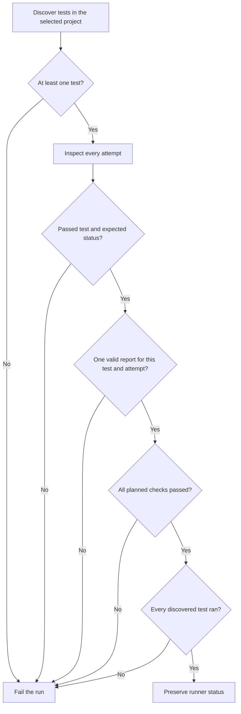

# Require complete journeys in CI

`keytrail/ci-guard` is a Playwright reporter. It makes a successful runner exit with a
failure when any discovered test in the selected project lacks a complete passing
journey. Use one assertion per test and name the project explicitly:

```ts
import { defineConfig } from '@playwright/test';

export default defineConfig({
  forbidOnly: !!process.env.CI,
  projects: [{ name: 'journey', testMatch: '**/*.journey.spec.ts' }],
  reporter: [['list'], ['keytrail/ci-guard', { projectName: 'journey' }]],
});
```

```sh
npx playwright test --project=journey
```

`projectName` defaults to `journey`. Empty or non-string values fail the guard.
Place the guard **last**: a later reporter can override the final status again.
Keep the command and required suite under repository review and make the job required
by your branch rules. A CLI `--reporter` override replaces the configured reporters.

## What is enforced



For every attempt, the reporter requires:

- Actual and expected Playwright statuses both `passed`.
- Exactly one `journey-result.json`, MIME type `application/json`, supplied by a body
  or regular file, at most **5 MiB**. Malformed UTF-8, JSON and schema v1 are rejected.
- SHA-256 of the actual Playwright test ID in `run.testRef`; the actual retry index
  in `run.attempt`; a distinct `run.runId`.
- Coverage counts equal to the checks, consistent outcome, unique check/step IDs,
  valid step/dependency references, message codes and scenario rule family.
- `outcome: "passed"`, `coverage.complete: true` and entry evidence reached.

A failure is sticky across retries. A later passed attempt cannot erase an earlier
failed, skipped, timed-out or incomplete attempt. Expected failures and fixmes also
fail this project. An empty selection fails even with `--pass-with-no-tests`.
Dependency projects do not need journey attachments. Their runner failure is preserved;
if it prevents journey tests from starting, those tests also fail the completeness check.

The guard returns `{ status: 'failed' }` from `onEnd` when a previously passing run
has violations. It preserves `failed`, `timedout` and `interrupted`. Throwing alone
would be insufficient: [Playwright swallows reporter errors](https://playwright.dev/docs/api/class-reporter).
File reading, parsing and internal callback errors become violations. Synchronous,
bounded file reads finish within `onTestEnd`; there is no unawaited validation task.

## Read a violation

```text
[KeyTrail CI] ATTACHMENT_COUNT testRef=<sha256> attempt=0
[KeyTrail CI] JOURNEY_INCOMPLETE testRef=<sha256> attempt=0
```

| Code group | Action |
| --- | --- |
| `EMPTY_SUITE`, `TEST_NOT_RUN`, `CONFIG_INVALID` | Check project selection, discovery, setup and guard configuration. |
| `TEST_STATUS`, `EXPECTED_STATUS` | Inspect the test failure, timeout, skip or expected-failure annotation. |
| `ATTACHMENT_*` | Restore exactly one readable JSON attachment within the size limit. |
| `REPORT_JSON`, `REPORT_INVALID` | Inspect the report against schema v1 and its coverage/references. |
| `TEST_REF`, `ATTEMPT_REF`, `RUN_REPEATED`, `ATTEMPT_REPEATED` | Do not reuse reports between tests or attempts. |
| `JOURNEY_INCOMPLETE` | Resolve failed/blocked checks; do not catch and ignore a journey failure. |
| `TEST_UNEXPECTED`, `RUN_ERROR`, `INTERNAL_ERROR` | Inspect runner integration; the guard cannot accept this run. |

Guard diagnostics contain fixed codes, hashed test references and retry numbers only.
They omit test titles, project names, attachment paths, JSON contents and raw errors.
Output is capped at 20 diagnostic lines; further violations still fail the verdict.
Playwright and other reporters have their own data-handling behavior.

## Try and verify

After installing the archive into a consumer and copying `examples/vanilla`, run:

```sh
npx playwright test --config=examples/vanilla/playwright.guard.config.ts --project=journey
```

That configuration selects the three corrected teaching examples. The ordinary example
configuration also tests intentionally broken components by catching the expected
assertion. Those detector tests belong outside an application journey project.

`pnpm test:guard` launches actual Playwright child processes and checks their exit
codes, including recovered retries, empty discovery, dependency failure, corrupt
attachments, internal errors, timeout and SIGINT. It writes
`artifacts/guard-verification.json`; the [recorded evidence](https://github.com/PerchAnton/keytrail/blob/3620f256aea5997938f2565236af381cfe79a91a/docs/evidence/ci-guard.json)
includes source hashes. `pnpm test:package` additionally runs three real browser
journeys with the installed reporter in a fresh offline consumer.

## Boundaries

The guard covers **discovered tests**, not removed tests or files excluded by filters,
shards, configuration or `--no-deps`. Apply it in every shard that should discover
journeys; an empty shard fails. It is tested during ordinary runs, not blob-report
merging. It is not tamper-proof: trusted test code can fabricate JSON, identifiers or
coverage. It cannot reconstruct the original contract from a report or prove that a
required scenario was declared. A passing verdict is not an accessibility certification.
The guard does not enable itself, create branch protections or change artifact retention.
