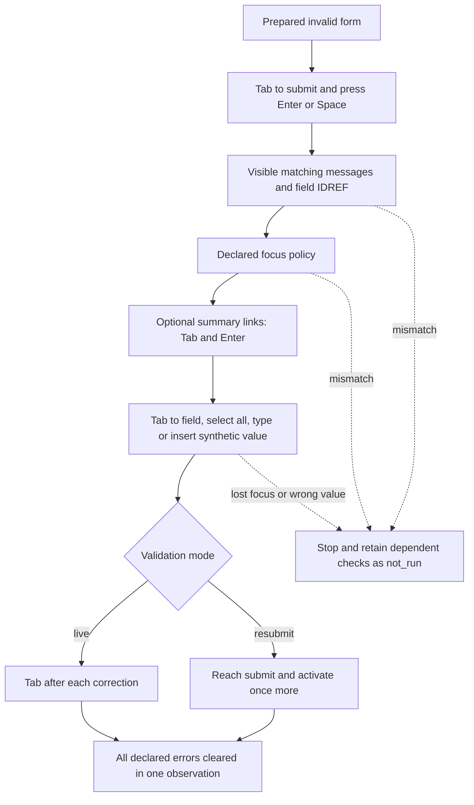

# Form error journeys

`assertFormErrorsJourney(page, testInfo, contract)` tests a declared correction path:
submit invalid data, inspect messages and field relationships, check focus, follow
optional summary links, correct the fields, then confirm that the errors clear.
It attaches one result and throws on failure or blocking, like the [dialog API](api.md).



The complete [HTML](../examples/vanilla/form-errors.html) and
[working/broken test](../examples/vanilla/form-errors.journey.spec.ts) run from an installed
tarball through `pnpm test:package`. They make no network requests.

```ts
import { assertFormErrorsJourney } from 'keytrail';

const email = { id: 'email', locator: page.getByLabel('Email', { exact: true }) };
await assertFormErrorsJourney(page, testInfo, {
  id: 'contact-errors',
  form: { id: 'contact', locator: page.locator('#contact') },
  submit: { id: 'save', locator: page.getByRole('button', { name: 'Save', exact: true }) },
  submitKey: 'Enter',
  errors: [{
    field: email,
    message: { id: 'email-error', locator: page.locator('#email-error') },
    via: 'aria-describedby', expectedText: 'Enter a valid email address.',
  }],
  focusAfterInvalid: { policy: 'firstInvalid', target: email },
  correction: [{ field: email, value: 'reader@example.test' }],
  inputMode: 'type',
  validateCorrection: 'live',
});
```

## Contract

Use a native `form` with `novalidate` and a `button type="submit"` inside it.
Declare 1–20 distinct erroneous fields. Each must be an `input` of type `text`, `email`,
`search`, `tel`, `url` or `password`, or a `textarea`, inside and owned by that form.
Messages and the summary may be outside the form in the same document. Targets follow
the identity and snapshot rules in the [common API](api.md).

| Field | Meaning |
| --- | --- |
| `errors` | Field/message pairs with `via` equal to `aria-describedby` or `aria-errormessage`, and `expectedText` |
| `focusAfterInvalid` | `firstInvalid` targeting the first `errors.field`; `stay` targeting `submit`; or `summary` targeting the application's summary |
| `summaryLinks` | Optional `{ link, field }` pairs; each field belongs to `errors`, and link Targets do not repeat |
| `correction` | Every erroneous field exactly once, in the desired correction order, with a synthetic string of at most 256 Unicode code points |
| `inputMode` | `insertText` (default, Unicode input) or `type` (per-character keyboard events, printable ASCII only) |
| `validateCorrection` | `live` blurs each corrected field with Tab; `resubmit` activates submit again after all corrections |

These focus policies are application choices. They are not a universal requirement
for every form. The W3C explanation of [error identification](https://www.w3.org/WAI/WCAG22/Understanding/error-identification.html)
provides context for textual messages; KeyTrail's detailed keyboard contract goes beyond that criterion.

Strings match the whole message after trimming and collapsing whitespace. Regular
expressions run on that normalized text; stateful `g` and `y` flags are rejected.
Text must be nonempty and rendered. A field must have `aria-invalid="true"` and its
chosen IDREF list must include the message's unique DOM ID. Additional descriptions
are allowed; references to a different declared error and duplicate DOM IDs fail.

## Keyboard actions and limits

Each reach operation starts from current focus and uses at most `entry.maxTabs` Tabs.
No click, `fill`, forced focus or DOM repair is used. Before correction, focus and
editability are checked again. KeyTrail presses `ControlOrMeta+A`, then uses the
selected `inputMode`. Empty values use Backspace in either mode.

| Mode | What is exercised | Supported values |
| --- | --- | --- |
| `insertText` (default) | [`keyboard.insertText`](https://playwright.dev/docs/api/class-keyboard#keyboard-insert-text); an input event without character key events | Up to 256 Unicode code points |
| `type` | [`keyboard.type`](https://playwright.dev/docs/api/class-keyboard#keyboard-type), one character at a time, including keydown/keypress/input/keyup as permitted by the component | Up to 256 printable ASCII characters, U+0020–U+007E |

Use `type` when a keyboard handler could prevent text entry. For example, a form
that cancels character `keydown` events can accept `insertText` yet fail `type`
with `VALUE_MISMATCH`. Other characters, control characters and line breaks in
`type` mode block the contract with `CONFIG_INVALID` before submission; there is
no silent fallback to insertion. IME and physical keyboard layouts remain outside
scope. The insertion default preserves existing contracts.

Focus and editability are checked before every character. A focus change stops
further typing. Each character consumes one of the journey's 500 actions, so long
values across many fields may hit `ACTION_LIMIT`. `config.inputMode` records the
selected mode even when the journey stops early. A character step has
`actionKind: "type"` and `key: null`; neither character nor value is recorded.
The final value is compared exactly in both modes, without including it in JSON.

Common time budgets also apply. Native validation,
select/date/contenteditable controls, foreign documents and observed ShadowRoot
targets are unsupported. [All limits and data handling](limits.md).

## Checks and diagnosis

| Rule | Observation |
| --- | --- |
| F01 | Supported form boundary, keyboard entry and one invalid-submit key |
| F02 | All declared messages visible and matching in the same observation |
| F03 | Invalid state and unique message IDREF for each field |
| F04 | The declared post-error focus target |
| F05 | Each summary link reached by Tab; Enter focuses its declared field |
| F06 | Keyboard correction, exact value, optional blur/resubmit, and all errors cleared |

For example, `F06.clear.001` with `ERROR_NOT_CLEARED` identifies the first declared
error that remains after correction. `TEXT_MISMATCH`, `IDREF_MISMATCH`,
`INVALID_STATE_MISMATCH`, `FOCUS_MISMATCH` and `VALUE_MISMATCH` distinguish earlier
failures. A read-only field blocks correction with `NOT_EDITABLE`. Unsupported form
structure or a changed field boundary blocks with `UNSUPPORTED_FORM`; missing required
elements can fail `STRUCTURE_MISMATCH`. Remaining checks keep their `blockedBy` dependency.

Final clearing requires hidden/removed messages and absent or `false` `aria-invalid`
for every declared field in one observation. It does not prove server persistence,
success-message accessibility, screen-reader announcements, or unlisted errors.
Native `href="#field-id"` summary links are supported. Only the declared link activation
may change the URL fragment, and KeyTrail checks the original Document identity before
accepting the result. A reload of the same URL still blocks. Other navigation, popups
and Page closure also block. Mock real submissions in test setup.

Own JSON stores only technical IDs and measured facts. Correction values, text,
patterns, DOM IDs and raw errors are excluded. Playwright's external reports can
still contain input and locators, so examples use synthetic values throughout.
