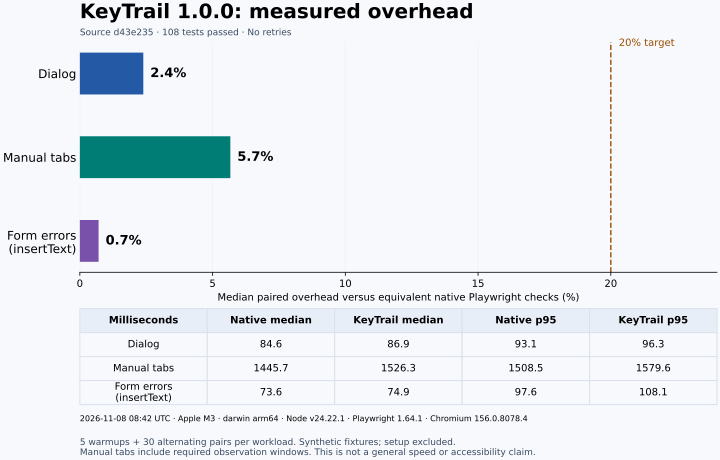
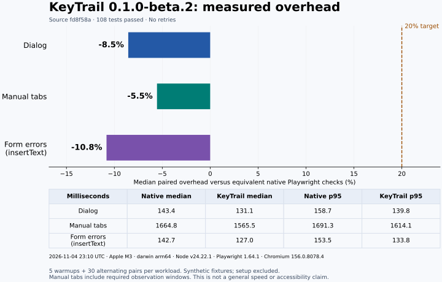
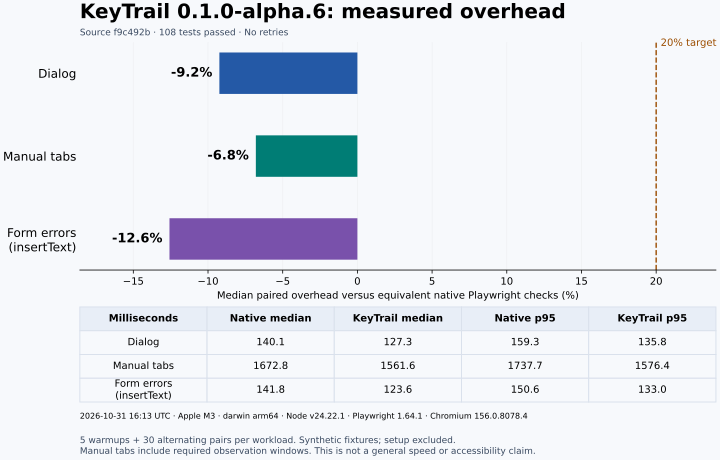

# Equivalent-work benchmark

**1.0.0 source qualification complete; registry publication pending.** [Release checklist](releases/1.0.0.md).
Source `d43e235` passed **10 × 188 = 1,880** sequential checks and **188** matching
four-worker checks, with zero retries/skips and the unchanged **100 ms** bound.
All eleven raw reports were independently validated: **1,771 unique journey IDs**,
maximum passing observation gap **47.7 ms**.
[Raw-report hashes and validation](evidence/reliability-validation-d43e235.json).
Historical 0.1.0/alpha/beta results below retain their original identities.


## 1.0.0 measurements on `d43e235`

All **108 checks passed** on the recorded Apple M3/macOS ARM environment,
with five warmups and thirty alternating measured pairs per workload. Both
independently recomputed overhead calculations meet the unchanged 20% criterion.



| Workload | KeyTrail median (ms) | Native median (ms) | Median paired overhead | Ratio of medians |
| --- | ---: | ---: | ---: | ---: |
| Dialog | 86.9 | 84.6 | 2.4% | 2.7% |
| Manual tabs | 1526.3 | 1445.7 | 5.7% | 5.6% |
| Form errors (insertText) | 74.9 | 73.6 | 0.7% | 1.8% |

[Independent pair-level validation](evidence/benchmark-validation-d43e235.json).
These synthetic fixtures do not establish a general speed advantage, adoption,
or future shared-runner latency. Both implementations changed since earlier
measurements, so historical numbers are not a controlled speedup comparison.

## Qualification investigation

Three complete benchmark attempts on 8 November were rejected (105/108,
106/108 and 106/108). Manual-tab observation gaps exceeded 100 ms. Failed
samples are preserved and excluded from performance claims, not replaced individually.

Diagnostic CPU profiles identified stack-formatting work in the reference's
Playwright transport calls. Short-stack dispatch reduced that work but did not
eliminate the failures. A separate timing trace reproduced a 120.3 ms gap with
99.5 ms of host idle time and no overlapping host GC; this is evidence of waiting
for browser/transport work, not proof of a particular operating-system cause.

The fixture-specific native reference now resolves its simple CSS target union
in one request, retaining per-selector counts and the independent live ARIA
queries. It still performs every check and records actual browser timestamps.
KeyTrail's existing guarded query grouping now covers complete observations too:
every original locator is re-evaluated, unexpected/missing members or mutations
trigger a fresh fallback read, and semantic metadata is included for complete
reads. No targets, states or successful timestamps are reused across readings.

Eight binding/mutation regressions additionally cover complete reads. The strict
report validator explicitly recognizes those cases and still rejects unknown
ones. The API, defaults, deadlines and 100 ms bound are unchanged. Short pilot
results are diagnostic only; the new full benchmark and final series are recorded above.
Earlier reference timings are not a controlled before/after comparison.

## 0.1.0 measurements on `85cee8c`

All 108 checks passed on Apple M4/macOS ARM, Node 24.22.1 and Chromium 156.0.8078.4.
Each synthetic workload used five warmups and thirty alternating measured pairs,
plus a defect control. Both overhead calculations met the unchanged 20% bound.

| Workload | KeyTrail median (ms) | Native median (ms) | Median paired overhead | Ratio of medians |
| --- | ---: | ---: | ---: | ---: |
| dialog | 121.4 | 130.9 | -7.6% | -7.3% |
| tabs | 1539.5 | 1606.3 | -4.7% | -4.2% |
| formErrors | 114.3 | 127.9 | -10.7% | -10.7% |

[Raw-report validation](evidence/benchmark-validation-85cee8c.json).
These samples do not establish a general speed advantage, real-world adoption
or future shared-runner reliability. Earlier measurements below remain historical.

**Beta.2 qualification.** Source `fd8f58a` completed ten rounds of 180 tests and the separate 180-test four-worker comparison. All eleven raw reports matched, with 1,771 distinct journey IDs and zero retries. [Beta.2 release notes](releases/0.1.0-beta.2.md) · [Independent validation](evidence/reliability-validation-fd8f58a.json).

## Beta.2 measurements on `fd8f58a`

All 108 tests passed on the recorded Mac. Each workload contributed five warmups, thirty alternating measured pairs and one defect control. Both overhead calculations met the 20% criterion in each of the three synthetic Chromium fixtures.



| Workload | KeyTrail median (ms) | Native median (ms) | Median paired overhead | Ratio of medians |
| --- | ---: | ---: | ---: | ---: |
| Dialog | 131.1 | 143.4 | -8.5% | -8.6% |
| Manual tabs | 1565.5 | 1664.8 | -5.5% | -6.0% |
| Form errors | 127.0 | 142.7 | -10.8% | -11.0% |

These results describe equivalent fixture work in this environment. [Pair-level validation](evidence/benchmark-validation.json).

## Historical alpha benchmark

The recorded measurements apply to merged main `f9c492b`, recorded on **31 October
2026 at 16:13 UTC** (18:13 in Kyiv). All **108 benchmark tests passed**, without
retries. Independent validation checked the complete raw report, all warmup and
measured pairs, semantic equivalence, negative controls, environment and source
hashes, then recomputed both overhead calculations; [validation record](https://github.com/PerchAnton/keytrail/blob/3620f256aea5997938f2565236af381cfe79a91a/docs/evidence/benchmark-validation.json).
No samples were discarded or selected from another run.

At the time of this benchmark (31 October 2026, 16:13 UTC), final reliability
verification for the frozen candidate had not yet run and was still deferred.
The `1187fde` candidate subsequently completed **100 × 172 = 17,200** sequential
test executions and **172** matching four-worker checks, with the unchanged
**100 ms** bound and zero retries/skips. Independent validation of all **101** raw
reports finished at **22:45 UTC on 31 October** (00:45 on 1 November in Kyiv).
See the [completed final series](reliability.md#historical-final-candidate-result-1187fde)
and its [validation record](evidence/reliability-validation-1187fde.json).
These are separate runs; the benchmark retains its original `f9c492b` identity.

The earlier [12:07 UTC measurements at `1b42666`](history/performance-1b42666-2026-10-31.md),
[October 31 measurements at `da7e663`](history/performance-da7e663-2026-10-31.md)
and [October 29 measurements](history/performance-2026-10-29.md) keep their original
source identities. Both KeyTrail and the native reference changed since those runs;
they do not form a controlled before/after speedup comparison.

The workloads are three synthetic Chromium journeys: a custom ARIA dialog, a
horizontal manual-activation tab list, and a two-field form with live error clearing
using `inputMode: "insertText"`. The opt-in per-character `type` mode is not measured.
The reference is fixture-specific native Playwright. These samples do not measure
real-world adoption, WCAG conformance or screen-reader behavior.

The observation-dispatch change is included in these measured inputs. Its CPU
profiles and hosted timing diagnostics remain separate evidence; see the
[dispatch investigation](observation-gaps.md) and [hosted checks](ci-concurrency.md).
The native reference uses its own direct Playwright calls. A negative percentage
means lower elapsed time than that fixed reference in this run; it does not mean
that KeyTrail is faster than every possible native test.

## Recorded results — 31 October 2026, 16:13 UTC (`f9c492b`)



| Workload | Native median / p95 (ms) | KeyTrail median / p95 (ms) | Median paired overhead | Ratio of medians |
| --- | --- | --- | --- | --- |
| Dialog | 140.1 / 159.3 | 127.3 / 135.8 | -9.2% | -9.1% |
| Manual tabs | 1672.8 / 1737.7 | 1561.6 / 1576.4 | -6.8% | -6.6% |
| Form errors (insertText) | 141.8 / 150.6 | 123.6 / 133.0 | -12.6% | -12.9% |

All three meet the 20% target under both calculations. The runner was an Apple M3
(8 logical CPUs), macOS arm64 / Darwin 27.2.0, Node 24.22.1, Playwright 1.64.1,
Chromium 156.0.8078.4; one worker, no concurrent test process observed at start.
Raw pairs and source hashes: [dialog](https://github.com/PerchAnton/keytrail/blob/3620f256aea5997938f2565236af381cfe79a91a/docs/evidence/benchmark-dialog.json),
[tabs](https://github.com/PerchAnton/keytrail/blob/3620f256aea5997938f2565236af381cfe79a91a/docs/evidence/benchmark-tabs.json), [forms](https://github.com/PerchAnton/keytrail/blob/3620f256aea5997938f2565236af381cfe79a91a/docs/evidence/benchmark-formErrors.json).
Values are rounded to one decimal place. The negative values describe this
sample only; it does not establish a general speed advantage, confidence interval
or cross-machine result. Required negative observation windows dominate its duration.

The chart can be regenerated with `python scripts/render-performance.py` in a
Python environment containing Matplotlib; it is an optional documentation tool.

## What the reference does

Both arms use the same page, keyboard action sequence, target resolution, focus and
role observations, time/action budgets, manual-activation observation windows, and
JSON result attachment. Both manual-tabs implementations require initial/final
snapshots and enforce the 100 ms gap threshold using browser timestamps. They start
consecutive asynchronous reads without an added host timer between snapshots.
Setup and page teardown are outside the measured interval.
The reference calls Playwright directly; it does not call KeyTrail's assertions,
driver, planner or serializer. Both arms validate the common report schema.

The [manifests](../benchmarks/manifests) were extracted once from verified fixture
traces and reviewed as fixed workloads. They specify the actions and expectations;
they contain no observed values or passing statuses. The reference reads the actual
browser state for each check. Every measured pair must agree on check IDs, statuses,
codes, expected/observed values, dependency references and action/focus traces, with
time and UUID fields excluded. A known defect per scenario must also produce the
same first failure and incomplete checks before measurements are accepted.

The native implementation supports only these three fixed fixtures. It is not a
second general-purpose journey library. Contract generality, unsupported modes and
fault handling are covered by KeyTrail's integration suite, not by these timing
samples. For a single short test, ordinary Playwright assertions may remain clearer.

## Protocol

Run on an otherwise idle machine with sleep disabled for the command:

```sh
pnpm build
pnpm benchmark
# macOS: caffeinate -is pnpm benchmark
```

Each arm has five warmups and 30 measured samples per scenario. Arm order alternates
AB/BA, with each arm first in 15 measured pairs. Each pair gets a fresh Playwright
test/context and each arm a new page. Measurements include contract setup, browser
work, report construction/validation and an identical in-memory attachment sink.
The sink checks the actual serialized result but excludes reporter filesystem I/O.
The real attachment path is covered separately by the integration and package tests.
There are 108 tests: three negative controls and 105 warmup/measurement pairs.

Median uses the average of the two middle values; p95 uses nearest rank. The primary
overhead is the median of the 30 paired percentages `(KeyTrail/native - 1) * 100`.
The ratio of the two medians is also published; the 20% target must pass under both
calculations. A fast result from one fixture does not offset a miss in another.
Raw pairs, versions, CPU and OS are retained with the summary.

Manual tabs deliberately include required negative observation windows. They dominate
elapsed time and can make percentage overhead look small; report milliseconds as
well. These measurements do not establish a universal speed advantage. A separate
machine, browser version or component can give different results.

An initial development experiment reused one Playwright test for all measurement
pairs. Accumulating internal step history distorted later measurements. Those numbers
were discarded before acceptance; this protocol resets that history for every pair.
