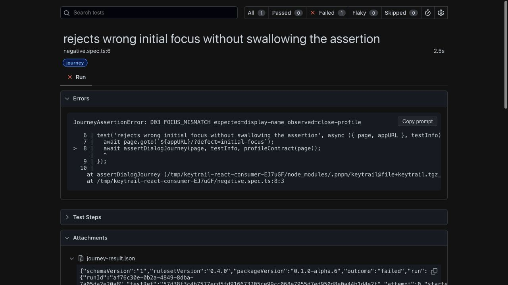
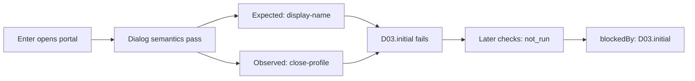

# Read the first mismatch

The three React teaching tests include two deliberate defects. A green teaching
test means the detector observed the expected result; it does not mean the broken
component is correct. Real application journeys must let `JourneyAssertionError`
fail the test. Keep the [CI guard](ci-guard.md) last in the reporter list.

After `pnpm test:package`, open the saved reports from the repository root:

```sh
pnpm exec playwright show-report artifacts/consumers/react-portal/reports/teaching/html
pnpm exec playwright show-report artifacts/consumers/react-portal/reports/negative/html
```

The second report is from a real failing process whose exit code **1** is expected
and verified by the package check. Expand the test, inspect the KeyTrail steps,
and open the `journey-result.json` attachment. JUnit is also saved alongside each
HTML folder as `junit.xml` for CI systems; `results.json` is Playwright's JSON output.

The screenshot below is from the intentionally failing React consumer in
[main CI](https://github.com/PerchAnton/keytrail/actions/runs/41104556559).
The red result is expected: this control verifies that a broken component fails
its process. It is not a new regression in the corrected fixture.



## Follow the evidence

For the wrong initial-focus variant:

```text
D03 FOCUS_MISMATCH expected=display-name observed=close-profile
```



The first mismatch explains why the journey stopped. `not_run` means there is no
evidence for that later observation; it is not a pass or an additional observed
component defect. Do not remove those entries when presenting the result.
The separate return-focus defect reaches the final `D07.returned` check and observes
`body` instead of `open-profile`.

The corrected React test checks that the dialog is physically outside the app root,
closes it, then runs a complete journey after remount. All three scenarios also
have [vanilla examples](../examples/vanilla) installed from the same archive.

## Data boundaries

KeyTrail's own attachment uses technical target IDs and allowlisted observations,
without input values, page text or selectors. Playwright HTML, JUnit, console logs,
traces and test titles have independent data behavior. This example uses synthetic
values and disables trace, screenshots and video. Apply your artifact retention
policy before using real application data. See [limits](limits.md).

Standard reporter configuration follows the
[Playwright reporter API](https://playwright.dev/docs/test-reporters).
