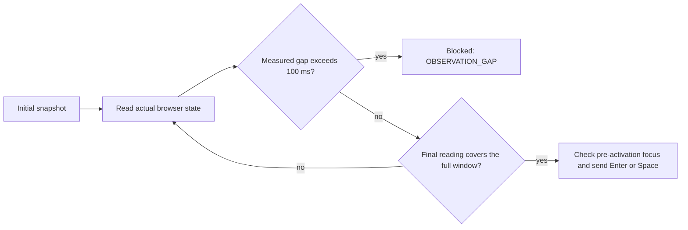

# Tabs journeys

`assertTabsJourney(page, testInfo, contract)` checks a fixed, LTR tab list in the main
document. Use at least two tabs, roving `tabindex`, and panels that remain mounted.
The keyboard and semantic expectations follow the [APG tabs pattern](https://www.w3.org/WAI/ARIA/apg/patterns/tabs/).

```ts
import { test } from '@playwright/test';
import { assertTabsJourney } from 'keytrail';

test('preferences tabs', async ({ page }, testInfo) => {
  await page.goto('/preferences'); // Prepare your application before the journey.
  const items = ['general', 'privacy'].map(id => ({
    tab: { id: `${id}-tab`, locator: page.locator(`#${id}-tab`) },
    panel: { id: `${id}-panel`, locator: page.locator(`#${id}-panel`) },
  }));
  await assertTabsJourney(page, testInfo, {
    id: 'preferences', tablist: { id: 'tablist', locator: page.getByRole('tablist') },
    items, initialTabId: 'general-tab', orientation: 'horizontal',
    activation: 'manual', activationKey: 'Enter', homeEnd: true,
    nextTabStop: items[0]!.panel,
  });
});
```

The runnable [HTML](../examples/vanilla/tabs.html) and [test](../examples/vanilla/tabs.journey.spec.ts)
include a correct component and an intentionally broken version. The latter selects a
tab on an arrow key and produces a diagnostic with the expected and observed selection:

```text
T05 PREMATURE_ACTIVATION expected-selected=general-tab observed-selected=privacy-tab
```

Keep a native Playwright
test when it describes your component more clearly or needs behavior outside this contract.

## Contract

| Field | Meaning |
| --- | --- |
| `tablist` | Container Target with role `tablist` and a nonempty accessible name |
| `items` | Complete ordered array of `{ tab, panel }` Target pairs; at least two |
| `initialTabId` | Technical Target ID of the tab selected at entry |
| `orientation` | `horizontal` or `vertical`; RTL is unsupported |
| `activation` | `automatic`, or `manual` with required `activationKey: 'Enter' \| 'Space'` |
| `homeEnd` | Defaults to false; enables Home and End checks when true |
| `nextTabStop` | Expected Target outside the tab list after the final Tab; may reuse the initial panel Target |

The [common limits and Target rules](api.md) apply. Up to 49 pairs fit the 100-Target
limit. Use the same Target object for a reused panel; a different ID pointing to the
same node blocks the journey. No disabled tabs, `aria-activedescendant`, dynamic item
composition, or panels mounted only while selected are supported.

## What runs

1. Enter with Tab, or record `already_focused` if focus is on the declared initial tab.
2. Check roles, name, orientation, membership and each pair's IDREF relationships.
   `aria-controls` must resolve uniquely to the corresponding panel. The panel's
   `aria-labelledby` must include the tab's unique DOM ID. DOM IDs are not reported.
3. Traverse one full cycle in each direction, including wraparound: Right/Left for
   horizontal lists, Down/Up for vertical lists.
4. For automatic activation, wait for the selected tab and its panel. For manual
   activation, observe unchanged selection and panel visibility for at least
   `observationWindowMs`, then send the declared activation key once.
5. If enabled, check Home and End with the same activation policy, then use confirmed
   arrow transitions to restore the initial selected tab.
6. Send one Tab and check `nextTabStop` outside the tab list. The expected destination
   always refers to the initial panel, even when Home and End are enabled.

During manual navigation, the focused tab owns `tabindex="0"` while the previous tab
remains selected until activation. Exactly one tab must be selected and one panel
visible after activation; inactive tabs explicitly use `aria-selected="false"`.
Panel visibility uses a nonzero bounding box and visible CSS visibility; an empty
panel is valid if its layout gives it a visible box.

```mermaid
sequenceDiagram
  participant Runner as KeyTrail
  participant Tabs as Tab list
  Runner->>Tabs: ArrowRight
  Tabs-->>Runner: Focus moves; selection stays
  loop Observation window
    Runner->>Tabs: Read focus, selection, visibility
    Tabs-->>Runner: Previous panel still selected
  end
  Runner->>Tabs: Enter or Space, once
  Tabs-->>Runner: New tab selected; its panel visible
  Runner->>Tabs: Continue only after checks pass
```

The negative window begins with a real snapshot after focus and roving checks,
and requires a final snapshot at least `observationWindowMs` later. Browser-side
monotonic timestamps measure the intervals between snapshots, including browser
round-trip and scheduling delays. Each next read starts immediately after the
previous snapshot is checked, without an added host timer. Awaiting the browser
read yields to asynchronous I/O; snapshots remain sequential. This uses more
observations during the bounded window and cannot guarantee scheduling latency
on a stalled host. Any measured gap **greater than 100 ms** produces `blocked / OBSERVATION_GAP`, stops before activation, and leaves
dependent checks `not_run`. A component mismatch observed in the same snapshot
retains its specific failure instead of being hidden by the timing problem.

Each negative check records `observationIntervalsMs`, `observationCount`,
`maxObservationGapMs` and `observationWindowMs`. The associated step also records
the window's measured span. The CI guard checks these relationships and rejects
a passing report whose samples do not cover the required window or exceed 100 ms.
Keep the browser clock running normally during a journey.



Sampling does not detect changes entirely between reads or after the recorded
window. `timeoutMs` bounds positive waits and `scenarioTimeoutMs` bounds the journey
cooperatively. Focus reads do not repair the component.

## Rules and diagnostics

| Rule | Observation | Typical failure |
| --- | --- | --- |
| T01 | Entry | `ENTRY_LIMIT` |
| T02 | Structure, roles, name, orientation, pairwise IDREF | `STRUCTURE_MISMATCH`, `ROLE_MISMATCH`, `NAME_MISSING`, `ORIENTATION_MISMATCH`, `IDREF_MISMATCH` |
| T03 | Arrow focus movement and wrap | `FOCUS_MISMATCH` |
| T04 | Automatic activation | `SELECTION_MISMATCH` |
| T05 | Manual negative window and activation | `PREMATURE_ACTIVATION`, `SELECTION_MISMATCH`, `FOCUS_MISMATCH`, `OBSERVATION_GAP` |
| T06 | Selection, visibility and roving focus | `SELECTION_MISMATCH`, `ROVING_MISMATCH` |
| T07 | Exit from the restored initial selection | `FOCUS_MISMATCH` |
| T08 | Optional Home/End focus movement | `FOCUS_MISMATCH` |

Check IDs distinguish each pair, direction and transition, such as
`T02.item.001.controls` or `T05.forward.001.unchanged`. Remaining observations stay
`not_run` with `blockedBy`. Known unsupported modes produce `UNSUPPORTED_TABS`.
Results use the shared [schema](../schema/journey-result.v1.json), safe messages and
attachment behavior. Passing does not establish screen-reader behavior or accessibility
conformance. Forms and CI completeness enforcement use their own contracts and reporter.
